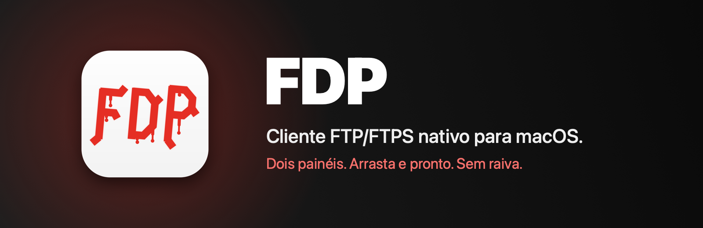
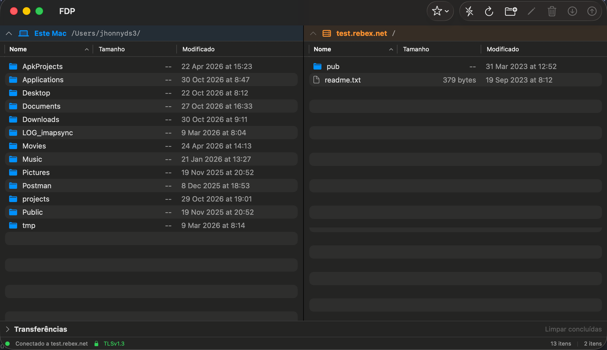
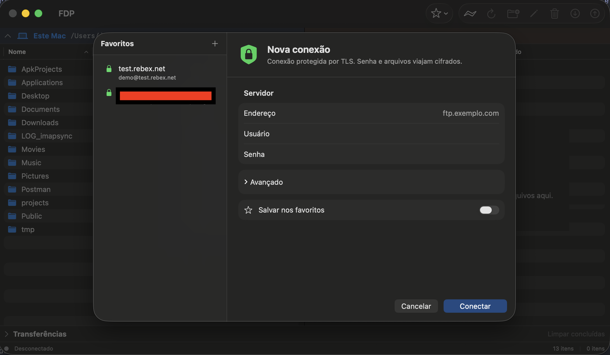

  

  
  
  
  
  
  

  

---

**FDP** é um cliente FTP/FTPS para macOS, nativo em Swift e SwiftUI. Nasceu da raiva com os clientes FTP que existem para Mac: tela de conexão confusa, visual de outra década, travamentos, transferências que você não sabe se terminaram, arrastar e soltar que não funciona e, o pior, um painel só.

Aqui são **dois painéis lado a lado, estilo Finder**: o seu Mac de um lado, o servidor do outro, cada um identificado por nome, ícone e cor. Arrasta de um pro outro e pronto.

  

  

## Instalação

1. Baixe o `.dmg` em [Releases](../../releases/latest).
2. Abra e arraste o **FDP** para a pasta **Aplicativos**.
3. Na primeira abertura o macOS avisa que não pôde verificar o app. Clique em **OK**, abra **Ajustes do Sistema**, **Privacidade e Segurança**, role até o fim e clique em **Abrir Mesmo Assim**. Só precisa fazer uma vez.

Por que o macOS avisa "desenvolvedor não identificado"?

 
O FDP é assinado localmente, sem conta de desenvolvedor Apple. O macOS mostra o aviso para qualquer app assim. No macOS 14 Sonoma, o atalho de clicar com o botão direito no FDP e escolher Abrir também funciona; no macOS 15 Sequoia e mais novos, só o caminho pelos Ajustes do Sistema libera o app.

Requer **macOS 14 Sonoma** ou mais novo.

## O que ele faz

| | |
|---|---|
| **Dois painéis espelhados** | Mac à esquerda, servidor à direita, mesmo desenho dos dois lados. Lista em colunas ordenável, duplo clique entra na pasta. |
| **Arrastar e soltar** | Entre os painéis nos dois sentidos, e do Finder direto para o servidor. |
| **Fila de transferências** | Painel recolhível com progresso, porcentagem, velocidade e cancelar. Conexão própria: navegar nunca espera uma transferência. |
| **Conflito pergunta** | Arquivo já existe? Substituir, manter os dois ou pular, com "aplicar a todos". Nada é sobrescrito sem você responder. |
| **Favoritos** | Servidor, usuário e porta salvos. Senha, se você pedir, vai só para o Keychain do macOS e exige Touch ID para ser usada. |
| **Operações de arquivo** | Nova pasta, renomear e apagar nos dois lados. Apagar no Mac vai para o Lixo. Apagar no servidor pede confirmação. |
| **Tudo em três lugares** | Menu da barra, toolbar com ícones e botão direito. Atalhos de teclado em todos. |
| **FTP e FTPS** | TLS explícito (`AUTH TLS`), ligado por padrão. TLS 1.3. Desligar mostra aviso em vermelho. |

## Segurança

Segurança não é opção escondida em "Avançado". É o padrão.

- **Certificado validado pelo macOS.** A cadeia do servidor é avaliada pelo Security framework, com as raízes de confiança do sistema e do seu Keychain, e com checagem do nome do host. Certificado errado é recusado. Se o macOS não reconhecer o certificado (autoassinado, comum em hospedagem), o FDP mostra nome, emissor, validade e impressão digital SHA-256 e deixa você confiar **naquele certificado específico**; se o servidor trocar de certificado, avisa de novo. Não existe "ignorar verificação".
- **Canal de dados retoma a sessão TLS do canal de controle**, como os servidores FTPS exigem. É a prova de que quem recebe o arquivo é o mesmo cliente que logou.
- **O app só conecta no host que você digitou.** Nunca em um endereço anunciado pelo servidor: no modo passivo (`EPSV`, ou `PASV` quando o servidor não aceita `EPSV`) só a porta da resposta é usada.
- **Senha nunca vai para arquivo.** Só para o Keychain, só se você pedir, e só sai de lá com Touch ID ou a senha do Mac.
- **Nada é sobrescrito nem apagado sem confirmação.** Download grava em arquivo temporário e só assume o nome final no fim: nunca sobra arquivo pela metade.
- **Timeout em toda espera de rede.** Servidor mudo não trava o app.
- Testado contra servidores reais de famílias diferentes (Rebex e vsftpd), com testes negativos para injeção de comando, certificado inválido e sobrescrita.

## Compatibilidade

| Servidor | Listagem | TLS | Status |
|---|---|---|---|
| vsftpd | `LIST` | 1.3 | Testado |
| Rebex | `MLSD` | 1.3 | Testado |
| Pure-FTPd (cPanel) | `MLSD` | 1.3 | Testado |
| ProFTPD | `MLSD` | | Deve funcionar; não testado ainda |
| IIS FTP | formato DOS | | Listagem não suportada ainda |
| SFTP | | | Não é FTP. Não suportado. |

## Roadmap

- [x] FTP e FTPS com reuso de sessão TLS
- [x] Dois painéis, arrastar e soltar, fila de transferências
- [x] Favoritos com Keychain e Touch ID
- [x] Nova pasta, renomear, apagar
- [x] Confiar em certificado autoassinado por servidor
- [ ] Transferir pastas inteiras
- [ ] Arrastar do servidor para o Finder
- [ ] Retomar transferência interrompida
- [ ] Atualização automática
- [ ] Notarização (depende de conta de desenvolvedor Apple)

## Por que "FDP"?

Ferramenta De Protocolo. Ou o que você gritou na última vez que usou um cliente FTP no Mac. Os dois valem.

## Código

O FDP é um software **proprietário e gratuito** ([licença](LICENSE.md)). O código-fonte não é público. Este repositório existe para distribuir as versões e receber feedback.

Encontrou um problema ou tem uma ideia? Abra uma [issue](../../issues). Informe a versão do FDP, a versão do macOS e, se puder, o servidor FTP que estava usando.

---

Feito em Swift, por quem precisava de um cliente FTP decente no Mac.

